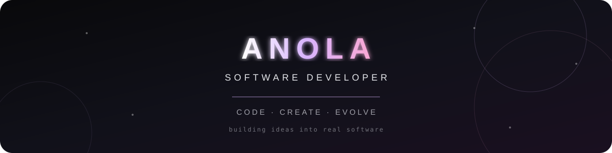

<div align="center">



<br/>


<br/><br/>


<br/><br/>

`01 — DISCOVER`   /   `02 — EXPERIMENT`   /   `03 — CREATE`

</div>

---


## `~/whoami`

Not here to write the same code twice.

I'm a developer in progress, exploring the world of software through experiments, creative problem-solving, and projects that challenge me to think differently.

I believe the best way to learn technology is to build with it.

<br clear="right"/>

---

## `~/toolkit`

<div align="center">


<br/><br/>

`FRONTEND`   ·   `BACKEND`   ·   `DATABASES`   ·   `TOOLS`

</div>

---

## `~/in_the_lab`

<div align="center">


</div>

```js
const nextVersion = {
  learn: "Every day",
  build: "Something meaningful",
  mistakes: "Part of the process",
  mission: "Become a better engineer"
};

console.log("Progress is in progress...");
```

---

## `~/the_rules`

<div align="center">

| PRINCIPLE | MEANING                     |
| :-------: | :-------------------------- |
|    `01`   | Stay curious                |
|    `02`   | Understand before copying   |
|    `03`   | Build before you feel ready |
|    `04`   | Let every mistake teach you |
|    `05`   | Never stop evolving         |

</div>

---

## `~/activity`

<div align="center">


<br/><br/>


</div>

---

<div align="center">


### `THINK DIFFERENTLY. BUILD FEARLESSLY.`

<sub>Designed with curiosity. Powered by code.</sub>

<br/>


</div>
